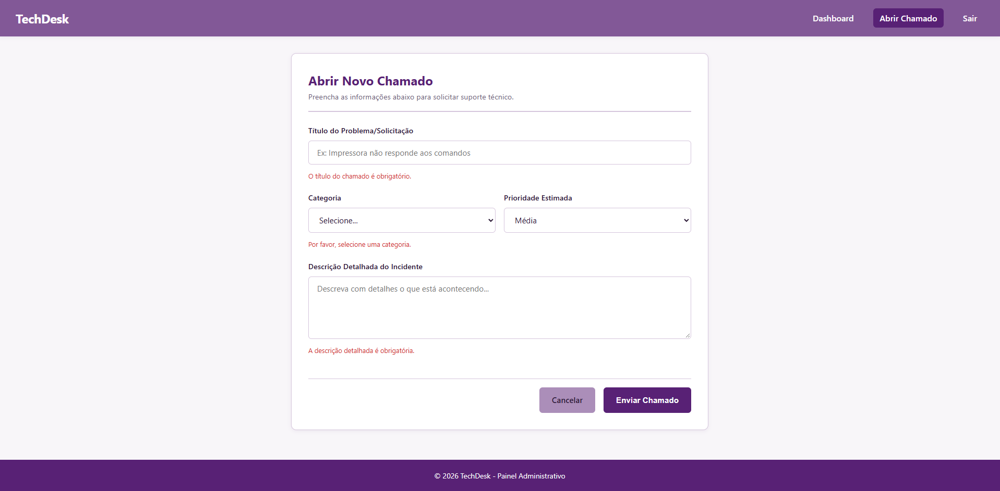
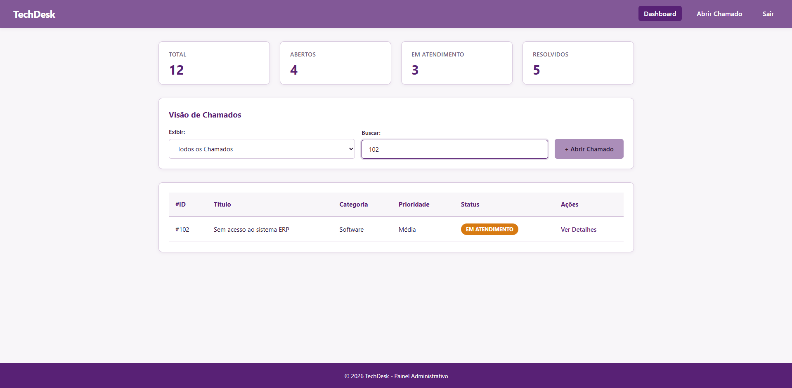
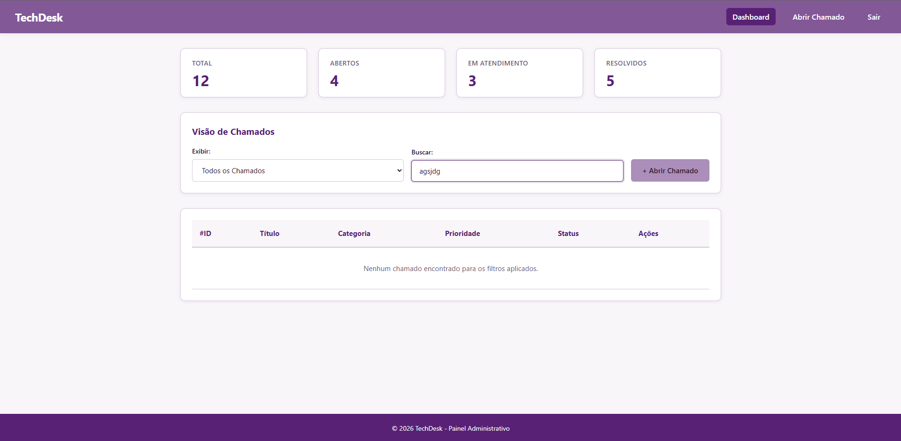
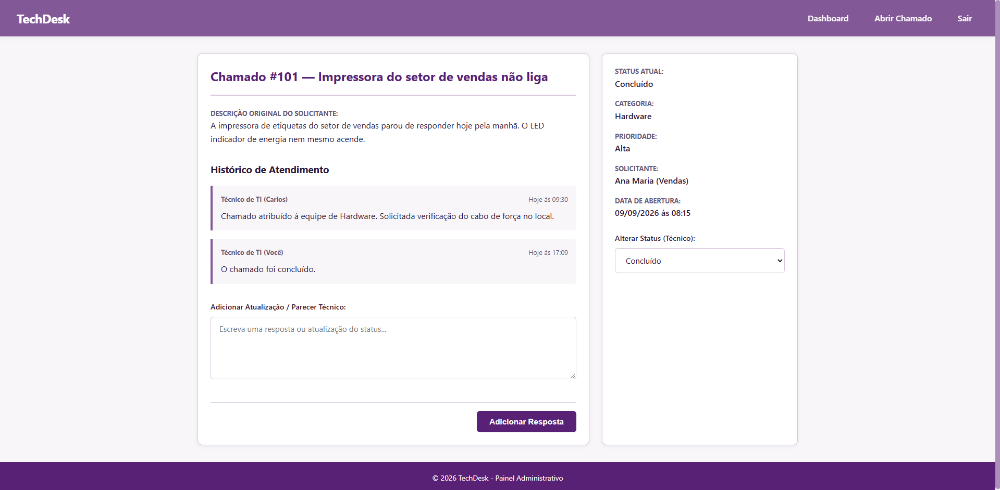

# Documentação da Etapa 04 — Interatividade com JavaScript

---

## 1. Descrição das Funcionalidades Interativas Implementadas

Foram desenvolvidas **4 funcionalidades interativas** modulares, distribuídas nas diferentes telas do sistema, cobrindo todos os requisitos de manipulação do DOM, eventos e tratamento de dados.

### Funcionalidade 1: Validação do Formulário de Acesso / Login
- **Arquivos envolvidos:** `src/js/login.js`, `src/html/index.html`.
- **Como funciona:** Intercepta o evento `submit` do formulário de autenticação e desativa a validação padrão do navegador (`novalidate`). O script verifica se os campos de e-mail e senha foram preenchidos e se o e-mail possui um formato válido (presença de `@` e ponto).
- **Conceitos utilizados:** Manipulação do DOM, tratamento de eventos, expressões/checagens condicionais, funções auxiliares de erro.
- **Validações e situações inválidas tratadas:** Impedimento de envio com campos vazios ou e-mail malformado. Exibição de mensagens de erro dinâmicas em vermelho abaixo de cada campo.

### Funcionalidade 2: Validação Dinâmica na Abertura de Chamados
- **Arquivos envolvidos:** `src/js/form-novo.js`, `src/html/novo_chamado.html`.
- **Como funciona:** Intercepta o envio do formulário de novo chamado (`submit`). Valida dinamicamente se o título atinge o limite mínimo de 5 caracteres, se a categoria foi selecionada e se a descrição detalhada possui pelo menos 10 caracteres. Se os dados forem válidos, simula a criação de um objeto de chamado com marcação de data/hora (`Date`) e redireciona para o painel principal.
- **Conceitos utilizados:** Objetos JavaScript, manipulação de strings (`trim()`, `length`), controle de eventos (`preventDefault()`), alteração dinâmica do DOM.
- **Validações e situações inválidas tratadas:** Bloqueio de submissão para campos não preenchidos ou com tamanho insuficiente de texto, removendo a mensagem de erro em tempo real assim que o usuário digita no campo (`input`).

### Funcionalidade 3: Filtro e Busca em Tempo Real na Dashboard
- **Arquivos envolvidos:** `src/js/dashboard.js`, `src/html/dashboard.html`.
- **Como funciona:** Escuta os eventos de digitação (`input`) no campo de busca por palavra-chave e alteração (`change`) no seletor de status/visão. O script percorre o conjunto de linhas da tabela (`<tr>`) e ajusta a propriedade CSS `display` para ocultar ou exibir cada chamado instantaneamente sem recarregar a página.
- **Conceitos utilizados:** Iteração em arrays/NodeLists (`forEach`), manipulação de strings (`toLowerCase()`), alteração dinâmica do DOM.
- **Validações e situações inválidas tratadas:** Tratamento de busca sem correspondência. Quando nenhum chamado atende aos filtros aplicados, o script insere dinamicamente uma linha informativa ("Nenhum chamado encontrado para os filtros aplicados") na tabela.

### Funcionalidade 4: Atualização Dinâmica do Histórico e Status do Chamado
- **Arquivos envolvidos:** `src/js/detalhes.js`, `src/html/detalhes_chamado.html`.
- **Como funciona:** Permite que o técnico insira uma atualização no formulário de detalhes. Ao submeter, o JavaScript captura a hora atual do sistema, cria dinamicamente um novo elemento de histórico (`<article>`) no DOM e o insere na linha do tempo (*timeline*). Além disso, ao alterar o `select` de status, o badge visual de status é atualizado imediatamente na barra lateral.
- **Conceitos utilizados:** Criação e inserção de nós no DOM (`createElement`, `appendChild`), manipulação de datas (`Date`), controle de classes CSS (`classList`).
- **Validações e situações inválidas tratadas:** Impede o envio de pareceres em branco ou compostos apenas por espaços em branco (`.trim() === ''`), exibindo um alerta visual em vermelho e destacando o campo.

---

## 2. Indicadores e Principais Conceitos de Programação Utilizados

1. **Manipulação do DOM:** Seleção de elementos (`document.getElementById`, `querySelector`, `querySelectorAll`), criação de nós (`createElement`), inserção (`appendChild`) e remoção de elementos (`remove`).
2. **Tratamento de Eventos:** Uso contínuo do padrão observer via `addEventListener` para eventos como `DOMContentLoaded`, `submit`, `input` e `change`.
3. **Validação de Formulários:** Interrupção do fluxo padrão (`event.preventDefault()`), verificação de regras de negócio em strings e desativação da validação nativa HTML5 (`novalidate`).
4. **Alteração Dinâmica da Interface:** Modificação em tempo real de classes visuais (`classList.add/remove`), alterações de estilos inline e injeção de conteúdos no layout.
5. **Uso de Funções:** Modularização em funções utilitárias reutilizáveis (como `mostrarErro()` e `removerErro()`) e funções de escopo para eventos.
6. **Uso de Arrays e Estruturas de Dados:** Manipulação de conjuntos de elementos (`NodeList`) convertidos ou manipulados como listas para varredura e filtro.
7. **Métodos de Iteração:** Emprego de `forEach()` para percorrer elementos da tabela e adicionar escutadores de eventos em múltiplos coletores de dados.
8. **Tratamento de Situacões Inválidas:** Verificação rigorosa contra entradas nulas, espaços em branco e ausência de resultados em filtros de dados.

---

## 3. Matriz de Evidências

| Requisito | Funcionalidade Relacionada | Arquivo(s) Envolvido(s) | Evidência de Implementação |
| :--- | :--- | :--- | :--- |
| **Manipulação do DOM** | Adição de parecer no histórico | `src/js/detalhes.js` | Utilização de `createElement('article')` e `appendChild()` na linha do tempo (`.timeline`). |
| **Tratamento de eventos** | Intercepção de formulários e filtros | `src/js/login.js` `src/js/form-novo.js` `src/js/dashboard.js` | Associação de manipuladores de eventos através de `addEventListener('submit')`, `addEventListener('input')` e `addEventListener('change')`. |
| **Validação de formulários** | Validação no login e na abertura de chamados | `src/js/login.js` `src/js/form-novo.js` | Checagem de tamanho mínimo de texto, formato de e-mail e cancelamento do envio com `event.preventDefault()`. |
| **Alteração dinâmica da interface** | Atualização de badge de status e erros visuais | `src/js/detalhes.js` `src/js/form-novo.js` | Injeção de elementos `` e alteração dinâmica de classes com `classList.add()`/`classList.remove()`. |
| **Uso de funções** | Centralização das rotinas de erro | `src/js/form-novo.js` `src/js/detalhes.js` `src/js/login.js` | Declaração e reuso das funções auxiliares `mostrarErro(campo, mensagem)` e `removerErro(campo)`. |
| **Uso de arrays** | Agrupamento de campos e linhas da tabela | `src/js/dashboard.js` `src/js/form-novo.js` | Coleta de linhas da tabela através de `querySelectorAll('tbody tr')` e manipulação em lote de inputs via array. |
| **Métodos de iteração** | Filtragem de chamados em tempo real | `src/js/dashboard.js` | Emprego do método `forEach` para percorrer e avaliar individualmente as linhas da tabela contra os filtros. |
| **Tratamento de situações inválidas** | Estado de busca vazia e campos com espaços em branco | `src/js/dashboard.js` `src/js/detalhes.js` | Inserção dinâmica da linha `#no-results-row` quando a busca é sem resultado e uso do `.trim()` para impedir envio de espaços em branco. |

---

## 4. Instruções de Execução e Teste

Para executar e validar as funcionalidades implementadas na **Etapa 04**, siga os passos abaixo:

1. **Testar Validação de Login (`index.html`):**
   - Abra o arquivo `src/html/index.html` no navegador.
   - Clique em "Entrar" sem preencher os campos para verificar as mensagens de erro.
   - Digite um e-mail sem `@` para validar o formato do campo.

2. **Testar Filtro e Busca na Dashboard (`dashboard.html`):**
   - Acesse `src/html/dashboard.html`.
   - No campo "Buscar", digite o termo `"Impressora"`. Note que apenas o chamado correspondente permanecerá visível.
   - Digite um termo inexistente (ex: `"xyz"`). Observe o surgimento da mensagem *"Nenhum chamado encontrado para os filtros aplicados"*.
   - Altere o filtro "Exibir" para isolar chamados por status.

3. **Testar Validação do Novo Chamado (`novo_chamado.html`):**
   - Acesse `src/html/novo_chamado.html`.
   - Clique em "Salvar / Submeter" com o formulário em branco.
   - Note as mensagens de erro em vermelho abaixo dos campos obrigatórios.
   - Comece a digitar nos campos para observar a remoção automática das mensagens de erro.

4. **Testar Histórico e Status (`detalhes_chamado.html`):**
   - Acesse `src/html/detalhes_chamado.html`.
   - Tente submeter um parecer técnico em branco ou preenchido apenas com espaços.
   - Preencha uma mensagem válida e clique em "Adicionar Parecer Técnico". Verifique o novo card anexado ao topo da linha do tempo com a hora atual.
   - Altere a opção no seletor "Alterar Status do Chamado" e observe o badge da barra lateral mudando de texto e cor dinamicamente.

   ---

## 5. Capturas de Tela das Evidências

### Validação da Tela de Login

### Validação do Formulário de Novo Chamado

### Filtro Dinâmico na Dashboard

### Inserção de Parecer Técnico no Histórico
