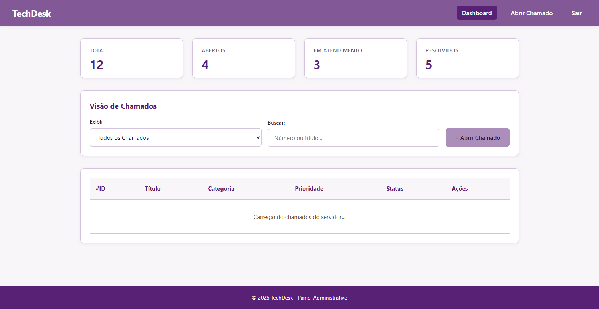
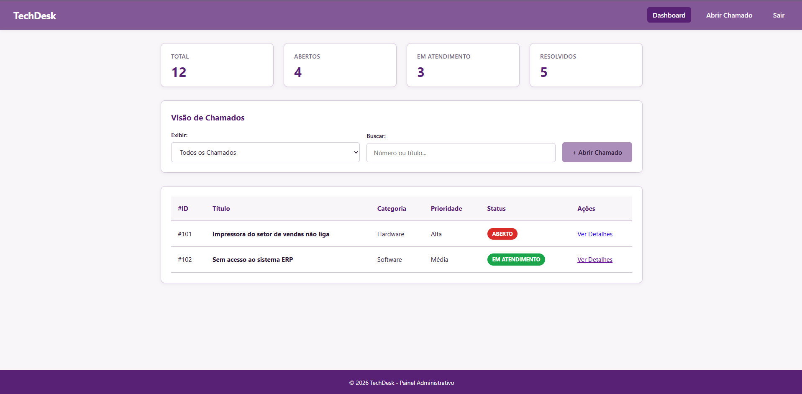
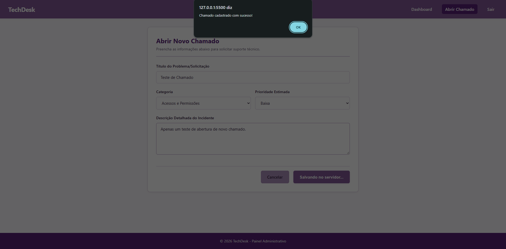
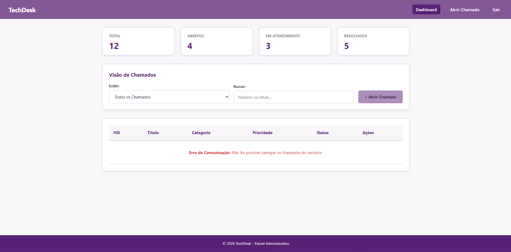

# Documentação da Etapa 05 — Modularização e Comunicação Assíncrona

## 1. Visão Geral

Nesta etapa, o projeto **TechDesk** evoluiu de uma aplicação puramente estática baseada apenas no DOM para uma arquitetura moderna orientada a serviços, preparando o front-end para consumir dados externos de forma assíncrona e organizada em módulos[cite: 1].

---

## 2. Requisitos Atendidos

- **Modularização:** O código JavaScript foi desacoplado e separado em responsabilidades bem definidas (`api.js`, `dashboard.js`, `form-novo.js`, `detalhes.js`)[cite: 1].
- **Comunicação Assíncrona:** Utilização da **Fetch API** em conjunto com `async/await` e `Promises` para interagir com o servidor simulado[cite: 1].
- **Gestão de Estados:** Implementação explícita de tratamentos visuais para:
  - **Carregamento (Loading):** Mensagens e estados de espera enquanto as requisições são processadas[cite: 1].
  - **Sucesso:** Renderização dinâmica dos dados obtidos ou confirmação e redirecionamento após o cadastro[cite: 1].
  - **Erro:** Tratamento de falhas de rede ou indisponibilidade do servidor[cite: 1].
- **Servidor Simulado:** Utilização do **JSON Server** (`db.json`) para simular uma API REST real[cite: 1].

---

## 3. Estrutura de Arquivos Criada / Modificada

```text
TechDesk/
│
├── db.json                     # Banco de dados simulado
├── docs/
│   ├── etapa-05.md             # Documentação oficial da Etapa 05
│   └── evidencias/
│       └── etapa-05/           # Pasta com as capturas de tela da etapa
└── src/
    ├── html/
    │   ├── dashboard.html
    │   ├── novo_chamado.html
    │   └── detalhes_chamado.html
    └── js/
        ├── services/
        │   └── api.js          # Módulo central de requisições (GET / POST)
        ├── dashboard.js        # Consumo de listagem e filtros com async/await
        ├── form-novo.js        # Submissão de novos registros via POST
        └── detalhes.js         # Consulta detalhada de chamados por ID
```

---

## 4. Instruções de Execução do Servidor Simulado (JSON Server)

Para testar as operações assíncronas de consulta e cadastro, é necessário rodar o servidor simulado localmente:

1. Certifique-se de ter o Node.js instalado na máquina.

2. Na raiz do projeto, instale o JSON Server (caso ainda não tenha feito):

   ```bash
   npm install -g json-server
   ```

3. Inicie o servidor apontando para o banco de dados local:

   ```bash
   json-server --watch db.json --port 3000
   ```

4. O servidor estará ativo em:

   `http://localhost:3000/chamados`

---

## 5. Capturas de Tela das Evidências

### Estado de Carregamento (Loading)



### Consulta de Dados com Sucesso (GET)



### Submissão de Dados ao Servidor (POST)



### Tratamento de Erro de Comunicação

